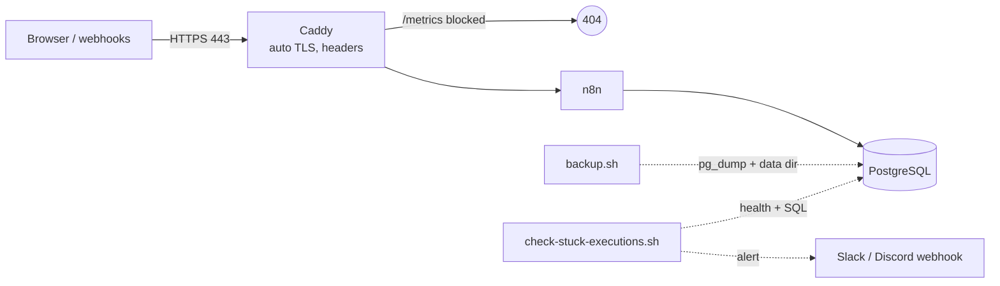

# n8n Self-Hosted Stack

[](https://github.com/J-F3diV/n8n-self-hosted-stack/actions/workflows/ci.yml)
[](https://github.com/n8n-io/n8n/releases)
[](LICENSE)

Self-hosted **n8n** on one server, set up the way you would run it for a client: **PostgreSQL**, automatic HTTPS with **Caddy**, **backups that are checked and actually restore**, and a **monitor for stuck executions**. CI boots the whole stack on every push and runs a weekly check.



## Why this exists

The default `docker run` setup works fine for a demo. In production you usually run into these problems:

| Problem | What this stack does |
|---|---|
| SQLite locks and grows forever | PostgreSQL, execution pruning enabled (14 days / 10k rows) |
| Manual certificates, mixed-content webhooks | Caddy with Let's Encrypt; `WEBHOOK_URL`, `N8N_PROXY_HOPS` set correctly |
| Lost encryption key → credentials can't be decrypted | Key generated once in `.env`, backup procedure points to it explicitly |
| Backups nobody ever tested | `pg_dump` is verified with `pg_restore --list`; CI runs a full **backup → restore** round trip |
| Executions stuck in "running" after a crash or OOM | `check-stuck-executions.sh` finds them in the DB and alerts |
| `/metrics` reachable from the internet | Blocked in Caddy, available on the internal network for Prometheus |
| Surprise breaking upgrades | All image versions pinned; weekly CI run |

## Quick start

Requirements: a Linux server with Docker Engine + Compose v2, ports 80/443 open, and a DNS record for your domain pointing to the server.

```sh
git clone https://github.com/J-F3diV/n8n-self-hosted-stack.git
cd n8n-self-hosted-stack
./scripts/init-env.sh n8n.your-domain.com   # creates .env with strong secrets
docker compose up -d --wait
```

Open `https://n8n.your-domain.com` and create the owner account.

> **Save `N8N_ENCRYPTION_KEY` from `.env` in your password manager now.** Without it, a restored database won't be able to decrypt any stored credentials.

To try it locally, run `./scripts/init-env.sh localhost`. Caddy then uses its internal CA, so your browser will show a certificate warning.

## Operations

### Backups

```sh
./scripts/backup.sh
```

This writes to `./backups/`:
- `n8n-db-<ts>.dump`: PostgreSQL custom-format dump, checked after it's written;
- `n8n-data-<ts>.tar.gz`: the n8n data directory (config, binary data);
- `n8n-<ts>.SHA256SUMS`: checksums.

Backups older than `BACKUP_RETENTION_DAYS` (default 14) are removed. Copy `./backups` off the server, e.g. with restic, rclone or your provider's snapshots.

Restore (**replaces the current database**):

```sh
./scripts/restore.sh --yes backups/n8n-db-<ts>.dump backups/n8n-data-<ts>.tar.gz
```

### Monitoring stuck executions

```sh
./scripts/check-stuck-executions.sh        # threshold from STUCK_AFTER_MINUTES (default 60)
./scripts/check-stuck-executions.sh 15     # custom threshold in minutes
```

It checks container health and lists executions in `new`/`running` older than the threshold. Exit codes: `0` healthy, `2` problems found, `1` check failed. If `ALERT_WEBHOOK_URL` is set, the report is also posted there (Slack/Discord/Mattermost-compatible).

> Note: `new` executions can also be waiting legitimately behind `N8N_CONCURRENCY_PRODUCTION_LIMIT`. Set the threshold above your longest expected queue time.

### Cron example

```cron
# daily backup at 03:15, health check every 10 minutes
15 3 * * *  cd /opt/n8n-self-hosted-stack && ./scripts/backup.sh >> backups/backup.log 2>&1
*/10 * * * * cd /opt/n8n-self-hosted-stack && ./scripts/check-stuck-executions.sh > /dev/null
```

The monitor runs on the host, outside n8n, so it keeps working even when n8n itself is down.

### Upgrades

1. `./scripts/backup.sh`
2. Read the [n8n release notes](https://github.com/n8n-io/n8n/releases) between your version and the target.
3. Change `N8N_VERSION` in `.env`, then `docker compose pull n8n && docker compose up -d --wait`.
4. If something breaks: set the old version back and restore the backup made in step 1. Database migrations are not reversible by downgrading alone.

## What CI verifies

On every push, pull request, and once a week, [`tests/smoke.sh`](tests/smoke.sh) runs on a clean GitHub runner and checks:

- the full stack starts and becomes healthy (`docker compose up --wait`);
- n8n answers through Caddy over HTTPS, and the editor UI is served;
- `/metrics` returns 404 from outside;
- the monitor passes on a fresh stack and **detects a synthetic stuck execution** (exit code 2, execution listed);
- backup is created, the database is changed, and **restore brings the original data back**, with n8n healthy afterwards.

Scripts are linted with `shellcheck`, and the compose file is validated.

Not covered: queue mode (Redis + workers), external task runners, multi-node HA. This stack is meant for single-server installs, which covers most small teams.

## Configuration reference

All settings live in `.env` (see [`.env.example`](.env.example)):

| Variable | Default | Purpose |
|---|---|---|
| `DOMAIN` | — | Public hostname |
| `N8N_VERSION` / `POSTGRES_VERSION` / `CADDY_VERSION` | pinned | Image versions |
| `TIMEZONE` | `Europe/Berlin` | Schedule trigger timezone |
| `N8N_ENCRYPTION_KEY` | generated | Credential encryption |
| `EXECUTIONS_DATA_MAX_AGE` | `336` h | Prune executions older than this |
| `EXECUTIONS_DATA_PRUNE_MAX_COUNT` | `10000` | Max stored executions |
| `BACKUP_DIR` / `BACKUP_RETENTION_DAYS` | `./backups` / `14` | Backups |
| `STUCK_AFTER_MINUTES` / `ALERT_WEBHOOK_URL` | `60` / empty | Monitoring |

## About

Maintained by **Yevhen Fediv** ([WiQuall](https://wiquall.com)), who contributed a fix to n8n core for executions left without a final status ([#41148](https://github.com/n8n-io/n8n/pull/41148), combined by the n8n team with a related fix in [#41937](https://github.com/n8n-io/n8n/pull/41937), released in 2.46.0).

Need help with setup, migrating from SQLite or n8n Cloud, or debugging hanging executions? Contact me via [wiquall.com](https://wiquall.com) or [Upwork](https://www.upwork.com/freelancers/~019ea5dd5820389ed0).

## License

[MIT](LICENSE)
